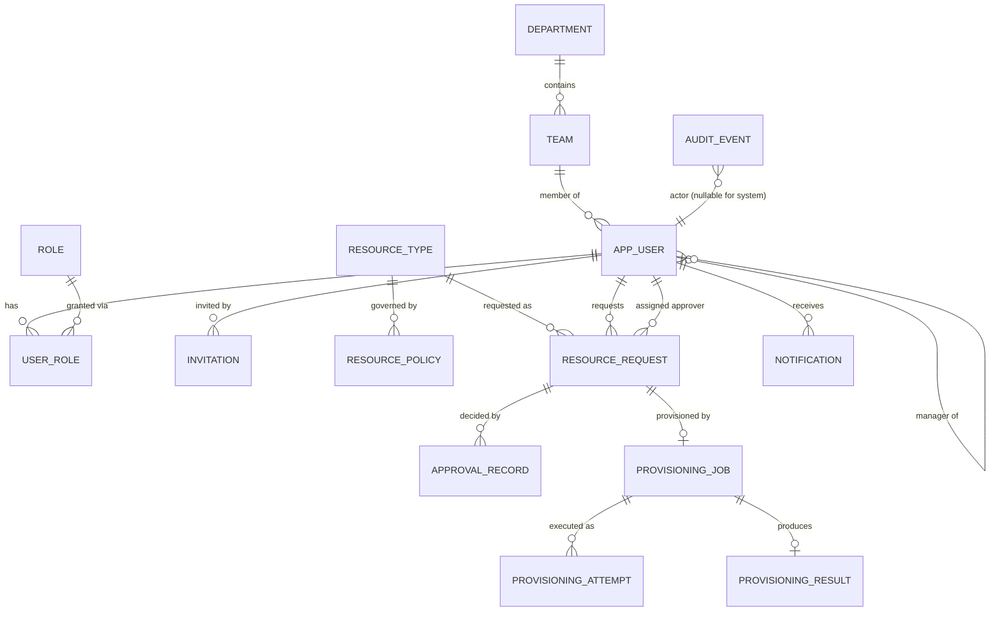

# Domain model

> Status: implemented.

## Identity and organization

| Entity | Key points |
|---|---|
| `User` (`app_user`) | Email normalized to lower case (`EmailAddress`), unique, and a DB `CHECK` enforces the normalization. Password hash, display name, status (`ACTIVE`, `DISABLED`), `manager_id` (nullable, `CHECK manager_id <> id`), `team_id`. Never deleted, only disabled, so history keeps resolving |
| `Role` | Java enum mirrored by a seeded `role` lookup table (FK target). It is not an editable entity because permissions are coded against these four values |
| `UserRole` | `user_role` table mapped as an `@ElementCollection` of `Role` on `User`. Eagerly loaded (tiny, always needed for authorization) and batch-fetched for pages |
| `Department`, `Team` | A team belongs to one department. Names are unique case-insensitively (globally for departments, per department for teams) |
| `Invitation` | The onboarding policy: an admin invites an email address with fixed roles, manager and team. Status `PENDING` → `ACCEPTED`/`REVOKED`, with expiry derived from `expires_at`. Only the SHA-256 hash of the 256-bit token is stored. A partial unique index allows one `PENDING` invitation per email |

**Hierarchy invariants** (enforced in `UserAdministrationService`):
- A manager must be an active user with the `MANAGER` role.
- No cycles. A recursive CTE checks the chain above the proposed manager. Hierarchy edits are serialized by a transaction-scoped PostgreSQL advisory lock, so two concurrent opposite assignments cannot both pass.
- A user with active direct reports cannot be disabled or lose the `MANAGER` role until the reports are reassigned. This guarantees that request submission always finds an eligible approver.

## Resource catalog

| Entity | Key points |
|---|---|
| `ResourceType` | `code` enum (`AWS_ACCOUNT`, `GCP_PROJECT`, `K8S_NAMESPACE`) → provider; display name, description, `enabled`. Seeded by migration, not creatable via the API ([ADR-0006](../decisions/0006-resource-spec-validation.md)) |
| `ResourcePolicy` | One per (type, `Environment` = DEVELOPMENT / STAGING / PRODUCTION): `allowed`, optional `maxActivePerUser`, type-specific `constraints` JSONB. Missing or `allowed=false` = deny |
| `ResourceSpecValidator` | One per type (Java). Validates request specs against naming rules and the policy, and validates policy constraints. Unknown fields are rejected |

| Type | Spec fields | Policy constraints |
|---|---|---|
| `AWS_ACCOUNT` | `accountName` (1–50), `email` (6–64), `organizationalUnitId` (`ou-…`) | `allowedOrganizationalUnitIds` (required if allowed), `allowedEmailDomains` |
| `GCP_PROJECT` | `projectId` (6–30, `[a-z][a-z0-9-]*[a-z0-9]`), `displayName` (optional, 4–30), `folderId` | `allowedFolderIds` (required if allowed) |
| `K8S_NAMESPACE` | `namespace` (DNS label ≤ 63, not `kube-*`/`default`), `cpuCores`, `memoryGi` (> 0, ≤ 3 decimals) | `maxCpuCores`, `maxMemoryGi` (required if allowed) |

## Request and approval

| Entity | Key points |
|---|---|
| `ResourceRequest` | UUID id; `request_number` `CF-<year>-<000123>` from a PostgreSQL sequence; `requester_id`; **`assigned_approver_id` captured at submission** and never changed; `resource_type_code` (FK to the catalog); `environment`; `spec` JSONB (≤ 16 KB, validated on submit, on approval and before provisioning); justification (10–2000 chars); status; `submitted_at`, `decided_at`; `version`. DB checks: approver ≠ requester; submitted ⇒ approver and time present |
| `ApprovalRecord` | request, approver, decision (`APPROVED`/`REJECTED`), comment (required for rejections, also a DB check), `decided_at`. Immutable; unique per request |

## Provisioning

| Entity | Key points |
|---|---|
| `ProvisioningJob` | One per request. `QUEUED → RUNNING → (AWAITING_PROVIDER ↔ RUNNING)* → SUCCEEDED / FAILED`; `attempt_count` (start calls only), `next_run_at`, lease (`locked_by`, `locked_until`; DB check: RUNNING ⇔ leased), `idempotency_key = cloudforge-<requestId>` (unique), `provider_operation_id`, `operation_started_at`, sanitized `last_error_*` |
| `ProvisioningAttempt` | Immutable history: START/POLL, worker, start and finish times, outcome, error code and sanitized message, operation ID |
| `ProvisioningResult` | External resource ID (namespace UID, `projects/<number>`, AWS account ID) plus non-secret details JSONB; unique per request |

## Audit and notifications

| Entity | Key points |
|---|---|
| `AuditEvent` | `occurred_at`, actor (`USER` + id, or `SYSTEM`), `AuditAction` (30 actions: request, provisioning, identity and security, catalog and organization), entity type and id, correlation id, details JSONB (never secrets). `@Immutable`; the repository has no update or delete methods; a **database trigger rejects UPDATE, DELETE and TRUNCATE** |
| `Notification` | recipient, type, title, body, request link, `read_at`. Created after commit from domain events; only the recipient can read or mark it |

## Identifier strategy

UUID primary keys are generated in the application (time-ordered UUIDv7 via Hibernate's `@UuidGenerator`). Time ordering keeps B-tree index inserts local, unlike random v4 values, and the ID is known before insert, so it can go into audit events and logs. Human-facing references use `request_number`, never the UUID.
