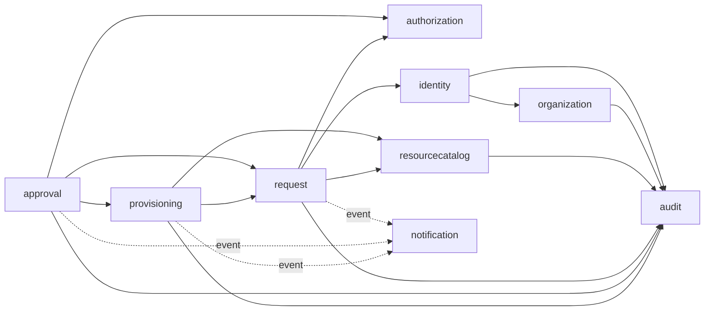
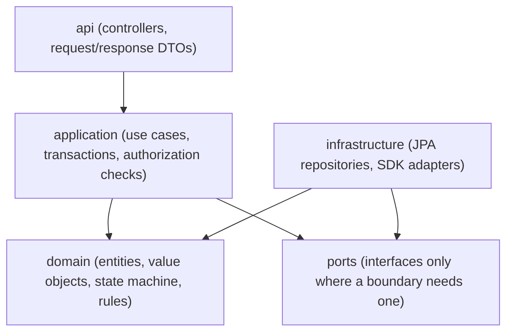

# CloudForge backend architecture overview

> Status: all backend phases (1–15) implemented. Sections marked *planned* describe the target design that later phases implement.

## Style: modular monolith

CloudForge is **one deployable Spring Boot application** made of feature modules with explicit boundaries. It is not a set of microservices. See [ADR-0001](../decisions/0001-modular-monolith.md).

Why this fits:

- The domain is tightly coupled. *Submit → approve → provision* is one consistency boundary, and a single PostgreSQL transaction protects it far more simply than a saga across services.
- One team, one release cadence, modest load. Microservices would add network failure modes, distributed tracing and multiple deploy pipelines without solving any problem we have.
- Module boundaries keep the option open: a module that talks to the others only through its public application API can be extracted later if a real need appears (for example, isolating the provisioning worker).

The application is **stateless** at the instance level. Authentication uses self-contained JWTs; refresh tokens, jobs and locks live in PostgreSQL, so instances can be scaled horizontally behind a load balancer.

## Module map

```
com.cloudforge
├── identity         users, roles, manager hierarchy, onboarding (invitations), credentials
├── organization     departments and teams
├── authorization    RequestAccessPolicy: role + ownership + approver relationship
├── resourcecatalog  resource types, per-type spec validators, per-environment policies
├── request          ResourceRequest aggregate, state machine, request numbers, scoped queries
├── approval         single-manager decisions, immutable ApprovalRecord
├── provisioning     PostgreSQL job queue, worker, retry policy, CloudProvisioningProvider port
│   └── provider/{aws,gcp,kubernetes,mock}   real SDK adapters + simulated provider
├── audit            append-only AuditEvent log (DB trigger), trail and search APIs
├── notification     in-app notifications created after commit
├── common           cross-cutting: error model, correlation IDs, base persistence types
└── config           Spring wiring: security, clock, JPA, scheduling
```

Each module uses only the subpackages it needs (`api` for controllers and DTOs, `application` for use-case services, `domain` for entities and rules, `infrastructure` for adapters and repositories). Not every module gets every layer.

### Dependency rules



- Solid arrows are direct calls to another module's **application service**, never to its repository or entities' internals.
- **Audit is a direct call** (`AuditLog.record`, `Propagation.MANDATORY`) in the business transaction: an audit row commits if and only if the change commits ([ADR-0007](../decisions/0007-audit-and-notification-delivery.md)). `audit` depends on no other module, so this creates no cycle.
- Dashed arrows are **in-process domain events** (`RequestSubmitted`, `RequestDecided`, `ProvisioningFinished`). `notification` consumes them **after commit** in its own transaction, so a notification never exists for a rolled-back change and can never undo one. See [provisioning-design.md](provisioning-design.md#outbox) for when a transactional outbox becomes necessary.
- Cross-module references are stored as IDs (`app_user.team_id`), not JPA associations. A module never navigates another module's entity graph, which prevents hidden coupling and accidental lazy loading.
- No module depends on `provisioning.provider.*`; only the provisioning worker resolves adapters, through the `CloudProvisioningProvider` port.

## Layers inside a module



- Controllers are thin: bind, validate, call one application service method, map to a DTO.
- Application services own transaction boundaries (`@Transactional`) and authorization decisions.
- Domain entities protect their invariants. For example, `ResourceRequest.approve(...)` refuses the transition when the request is not `PENDING_APPROVAL`.
- Interfaces are introduced only at real boundaries: cloud providers (several implementations), and the clock (through `java.time.Clock`). Repositories are Spring Data interfaces by nature. Services are concrete classes.

## Cross-cutting concerns (implemented)

| Concern | Implementation |
|---|---|
| Error format | RFC 9457 Problem Details with `code`, `correlationId` and `timestamp` (`common.error.GlobalExceptionHandler`), [ADR-0004](../decisions/0004-problem-details-error-model.md) |
| Correlation | `X-Correlation-Id` request/response header, put in the SLF4J MDC (`common.web.CorrelationIdFilter`). Unsafe client values are replaced |
| Time | One UTC `Clock` bean; Hibernate writes `TIMESTAMPTZ` in UTC |
| Schema | Flyway only; Hibernate `ddl-auto=validate` |
| Security | Stateless JWT bearer authentication (ADR-0003), deny by default, no generated default user, 401/403 as problem JSON, `CurrentUser` controller parameter from the verified token |
| Health | `/actuator/health/{liveness,readiness}` public; details hidden |
| Pagination | `PageResponse` JSON shape; size capped at 100; sort fields whitelisted per endpoint (`SortablePageRequest`) |
| Persistence base | `BaseEntity`: UUIDv7 id, `created_at`/`updated_at` from the app `Clock`, `@Version` optimistic locking |
| N+1 control | `hibernate.default_batch_fetch_size=100`: collections for a page load in one extra query |
| Logging | Plain text with correlation ID locally; `LOGGING_STRUCTURED_FORMAT_CONSOLE=ecs` gives JSON in deployed environments |
| Shutdown | Graceful, 30 s per phase, so in-flight requests and worker iterations can finish |

## Configuration profiles

| Profile | Purpose |
|---|---|
| *(none)* | Safe base. All connection settings come from `CLOUDFORGE_DB_*` environment variables; there are no fallbacks to a real database |
| `local` | Developer machine against `backend/compose.yaml` PostgreSQL. Password still comes from `.env` |
| tests | Testcontainers `@ServiceConnection` supplies the datasource |

Real cloud provisioning will need an **explicit** flag that is off by default in every profile. See [provisioning-design.md](provisioning-design.md#safety).
