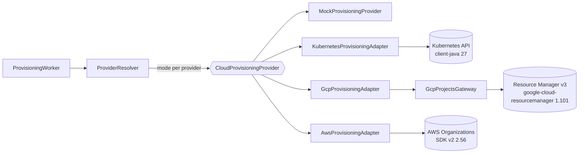
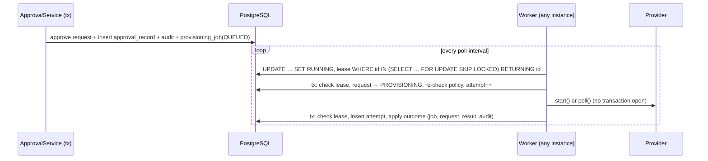

# Provisioning design

> Status: implemented (phases 10–13). Engine: `provisioning.application`; adapters: `provisioning.provider.{aws,gcp,kubernetes,mock}`.

## Port and adapters



```java
public interface CloudProvisioningProvider {
    ResourceTypeCode type();
    ProviderMode mode();                                   // MOCK or REAL
    ProvisioningOutcome start(ProvisioningCommand command);
    ProvisioningOutcome poll(ProvisioningCommand command, String operationId);
}
// sealed ProvisioningOutcome: Completed(externalId, details) | InProgress(operationId, pollAfter)
//                           | Failed(code, safeMessage, retryable)
```

Adapters never throw for expected provider errors. They classify them as retryable or permanent; the worker never sees SDK types.

## Adapters

| | Kubernetes namespace | GCP project | AWS account |
|---|---|---|---|
| Create | `POST /api/v1/namespaces` + `ResourceQuota cloudforge-quota` (cpu, memory requests and limits) | `projects.create` under `folders/{folderId}` | `CreateAccount`, then `MoveAccount` root → requested OU |
| Completion | synchronous | long-running operation; poll `operations.get` every 10 s | async; poll `DescribeCreateAccountStatus` every 30 s |
| Ownership marker | label `cloudforge.io/request-id` | label `cloudforge-request-id` | tag `cloudforge-request-id` |
| Idempotent retry | namespace exists with our label → ensure quota, complete; 409 on create → re-read and check | project exists with our label → complete | member account with this email and our tag → ensure OU, complete |
| Name taken by others | `NAMESPACE_TAKEN` (permanent) | `PROJECT_ID_TAKEN` (IDs are global and never reusable) | `EMAIL_ALREADY_IN_USE` |
| Retryable | network, 429, 5xx | UNAVAILABLE, DEADLINE_EXCEEDED, INTERNAL, ABORTED, RESOURCE_EXHAUSTED | TooManyRequests, ConcurrentModification, ServiceException, client/network errors |
| Permanent | 401/403, 400/422 | PERMISSION_DENIED, INVALID_ARGUMENT, FAILED_PRECONDITION; any **finished** operation error | AccessDenied, ConstraintViolation, InvalidInput, OrganizationsNotInUse; any FAILED creation status |
| Credentials | kubeconfig / in-cluster service account | Application Default Credentials (Workload Identity) | SDK default chain (IAM role, IRSA, Pod Identity) |
| Timeouts | connect 10 s, read 30 s | client defaults (< lease) | call 30 s, attempt 10 s |
| Tests | real client against MockWebServer | fake gateway with real proto types | mocked `OrganizationsClient` |

Provider error text is never copied verbatim into stored messages, because it can contain ARNs, service-account names or cluster internals. A finished long-running operation in error is treated as final (polling it again would return the same error); an administrator retry starts a fresh operation and relies on the ownership marker.

## Job queue

See [ADR-0005](../decisions/0005-postgres-job-queue.md).



| Outcome | Job | Request | Notes |
|---|---|---|---|
| Completed | SUCCEEDED | PROVISIONED | `provisioning_result` row; audit; notification |
| InProgress | AWAITING_PROVIDER, `next_run_at = now + pollAfter` (clamped 5 s – 5 min) | PROVISIONING | operation ID persisted; polls do not use attempts; fails `OPERATION_TIMEOUT` after `operation-timeout` (2 h) |
| Failed, retryable | QUEUED (or AWAITING_PROVIDER if polling), backoff | PROVISIONING | equal-jitter exponential backoff (30 s base, 15 min cap); after `max-attempts` (5) becomes permanent |
| Failed, permanent | FAILED | PROVISIONING_FAILED | approval history untouched; admin retry resets attempts |

**Recovery:** a worker that dies leaves its job RUNNING with a lease (5 min). When the lease expires, any worker can claim the job again. If a slow worker records a result after losing its lease, that result is discarded; idempotent adapters make the duplicate call harmless. The tests cover concurrent workers (exactly one execution), lease recovery, policy tightened after approval (no provider call), rejected or unapproved requests (never executed), provider exceptions, timeouts and admin retry.

**Metrics:** `cloudforge.provisioning.executions{type,kind,outcome}` counter (Micrometer, `/actuator/metrics`).

## Safety

| Setting | Default | Meaning |
|---|---|---|
| `cloudforge.provisioning.worker.enabled` | `false` | No polling at all; per instance |
| `cloudforge.provisioning.{aws,gcp,kubernetes}.mode` | `disabled` | `mock` = simulated; `real` = SDK adapter is created. Startup fails if `real` is set but the adapter cannot be built |
| `local` profile | worker on, all `mock` | development never touches a cloud |
| Tests | providers replaced by scripted fakes | real adapters are only unit-tested against fakes; `RealAdapterWiringTest` proves they exist only on explicit `real` |

Real cloud resources are created only with an explicit `mode=real` per provider, a credentialed workload identity, and an approved request that passes the policy at execution time. Grant each identity the minimum permissions listed in the adapter's configuration class.

## Outbox

Audit rows are written in the business transaction. Notifications are in-app rows created after commit (`NotificationListener`); a crash between commit and listener loses at most an in-app message, which the request status and audit trail duplicate. A **transactional outbox** becomes justified when events must reach *external* systems with delivery guarantees (email, chat, a message bus): insert the event in the business transaction and relay it with a worker like this one. `provisioning_job` is already a specialised outbox for cloud operations.
