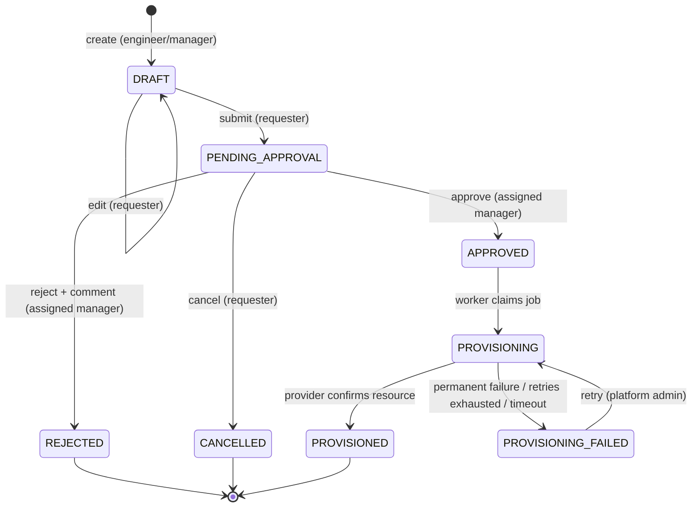

# Request lifecycle

> Status: implemented (phases 7–10). State machine: `request.domain.RequestStatus`; transitions: `ResourceRequest`.

Every other pair is rejected with `422 INVALID_STATE_TRANSITION`. `RequestStatusTest` checks the full 8×8 matrix. There is no endpoint that sets a status.

## Operations and their guards

| Operation | Endpoint | Who | Guards (in order) |
|---|---|---|---|
| create | `POST /api/requests` | ENGINEER or MANAGER, active | type exists and is enabled; spec is a JSON object of at most 16 KB. Requester = token subject (body fields ignored) |
| edit draft | `PUT /api/requests/{id}` | requester | status DRAFT |
| submit | `POST …/submit` | requester, active | has a manager; manager is active and holds MANAGER; spec valid for type and policy; environment allowed; quota (`maxActivePerUser`) under a per-user advisory lock. **Approver captured now** |
| cancel | `POST …/cancel` | requester, active | status PENDING_APPROVAL |
| approve | `POST …/approve` | assigned approver with MANAGER, active, ≠ requester | row lock; spec re-checked against the current policy; writes `ApprovalRecord`; **queues the provisioning job in the same transaction** |
| reject | `POST …/reject` | same as approve | comment required (API and DB check) |
| retry provisioning | `POST …/provisioning/retry` | PLATFORM_ADMIN | job FAILED; request PROVISIONING_FAILED |

Visibility (`GET /api/requests/{id}`, `/audit`, `/approval`, `/provisioning`): requester, assigned approver, PLATFORM_ADMIN, AUDITOR. Everyone else gets `404`.

## Concurrency

| Race | Protection |
|---|---|
| Approve vs. cancel, double approve | `SELECT … FOR UPDATE` on the request row in every state-changing operation, plus `@Version`; `approval_record.request_id` unique as a backstop. Tested with concurrent threads |
| Two submissions racing past the quota | `pg_advisory_xact_lock` per requester around count-then-submit |
| Manager reassignment during review | Approver is stored on the request at submission; later hierarchy changes do not move it (tested) |

## History preservation

`approval_record` is insert-only (`@Immutable`, repository without update or delete). A provisioning failure changes only `resource_request.status` and the job. Every transition writes an `audit_event` in the same transaction, and that table is append-only, enforced by a database trigger.
