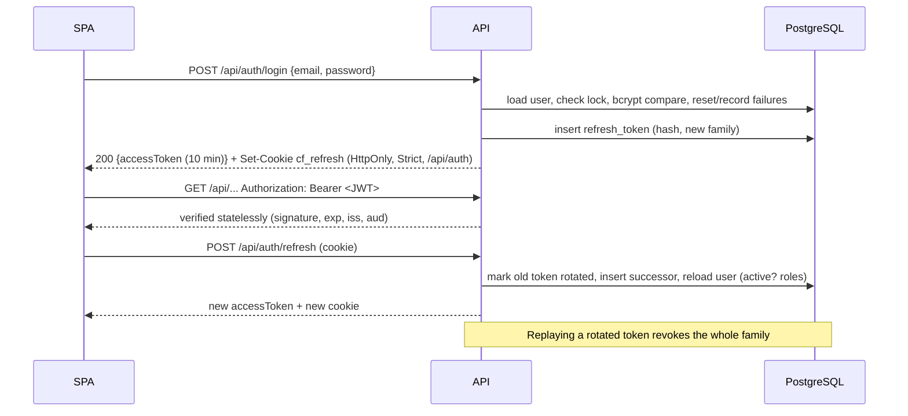

# Security model

> Status: implemented.

## Authentication (implemented)

Decision and trade-offs: [ADR-0003](../decisions/0003-jwt-authentication.md).

| Mechanism | Implementation |
|---|---|
| Password hashing | `DelegatingPasswordEncoder` (bcrypt, `{bcrypt}` prefix); hashes are upgraded on login if the default changes |
| Password policy | ≥ 12 characters (code points), ≤ 72 bytes (bcrypt limit), common-password blocklist, must not contain the email name (NIST 800-63B style, no composition rules) |
| Brute force | Per account: 5 consecutive failures → 1, 2, 4, 8, then at most 15 min lock (stops guessing one password). Per client address: 20 login or registration attempts per 5 min, shared by all instances through PostgreSQL (`LoginThrottle`), then `429` with `Retry-After` (stops credential stuffing across many accounts). Only the TCP peer address is used; configure `server.forward-headers-strategy` for a trusted proxy, and `X-Forwarded-For` is never read directly |
| Account discovery | Same `INVALID_CREDENTIALS` response for unknown, wrong password, disabled and locked; dummy bcrypt comparison keeps timing similar |
| Access token | HS256 JWT, 10 min, minimal claims, kept in SPA memory |
| Refresh token | Opaque 256-bit, SHA-256 at rest, `HttpOnly; Secure; SameSite=Strict; Path=/api/auth`, rotated per use, family revoked on reuse |
| Revocation | Logout → family; disable or role change → all of the user's refresh tokens; refresh re-checks status and roles |
| CSRF | Disabled: bearer-header authentication, plus the single Strict cookie |
| Registration | Invitation token only; email, roles, manager and team come from the invitation; extra payload fields are ignored |
| First admin | `AdminBootstrap` creates one `PLATFORM_ADMIN` from `CLOUDFORGE_BOOTSTRAP_ADMIN_*` only while no active admin exists; it never promotes existing accounts |
| Self-lockout | An admin cannot disable themselves or remove their own `PLATFORM_ADMIN` role |
| Actor identity | Controllers receive `CurrentUser` built from the verified token `sub`; services never take an actor or requester ID from the request body |

**Known window:** an access token issued before a disable or role change stays valid for up to 10 minutes (see ADR-0003).

## Authorization

Role checks alone are not enough, so every use case combines three checks.

1. **Role** (coarse, at the URL or method level): for example only `PLATFORM_ADMIN` can modify the catalog.
2. **Ownership**: an engineer reads only requests where `requester_id = me`.
3. **Relationship**: a manager decides only requests where `assigned_approver_id = me`, and never their own.

These checks live in `authorization.RequestAccessPolicy` as explicit methods (`requireView`, `requireOwner`, `requireDecider`, `requireProvisioningOperator`, `requireListScope`), called by application services. They are not scattered SpEL strings, which keeps them unit-testable. List queries apply the same rule as a `WHERE` clause (`scope=MINE|ASSIGNED|ALL`), so filtering happens in SQL and not in memory.

| Action | Rule |
|---|---|
| Create request | ENGINEER or MANAGER, account active |
| View request, trail, decision, provisioning | requester, assigned approver, PLATFORM_ADMIN, AUDITOR (others: 404) |
| Edit, submit, cancel | requester only |
| Approve or reject | assigned approver, still holding MANAGER, ≠ requester (self-approval → 422 `SELF_APPROVAL_FORBIDDEN`) |
| Retry provisioning | PLATFORM_ADMIN |
| Audit search | AUDITOR, PLATFORM_ADMIN |
| Notifications | recipient only (queries are scoped by recipient id) |

**Disabled users:** every state-changing operation re-checks that the acting account is still active (`requireActiveUser`), so a disabled user's not-yet-expired access token cannot change anything. Read access remains possible for at most the access-token lifetime.

**Information hiding.** When a user may not see a request, the API answers `404`, not `403`, so request IDs cannot be enumerated.

**Never trusted from the client:** requester id, approver id, status, roles and timestamps. They come from the authenticated principal and server-side state.

## Threats tracked

| Risk | Mitigation |
|---|---|
| Self-approval / approving others' requests | Approver captured at submit; actor = assigned approver ≠ requester; tests for both |
| Privilege escalation via registration | Roles come from the invitation, never from the payload (tested with an injected `roles` field) |
| Token forgery or tampering | Pinned HS256, signature, `exp`, `iss`, `aud` validation; tests cover tampered, foreign-key, wrong-audience, expired and `alg: none` tokens |
| Stolen refresh token | Rotation with family revocation on reuse; `HttpOnly` cookie unreadable by scripts |
| IDOR on `/requests/{id}` | Policy check plus 404 masking |
| Race to double-approve | Optimistic locking plus unique decision index |
| Data leakage through sorting | Sort fields whitelisted per endpoint (for example users cannot be sorted by `passwordHash`) |
| Invitation token theft | 256-bit random token, SHA-256 hash stored, returned once with `no-store`, redacted `toString()` |
| Credential leakage | No secrets in DB, config or logs; validation errors never echo values; 500s never include messages |
| Log injection | Correlation IDs strictly validated; structured logging in deployed environments |
| Accidental billable resources | Worker off and every provider `disabled` by default; `real` only on explicit per-provider opt-in (tested); policy re-checked right before execution; tests use scripted fakes |
| Audit tampering | No update or delete path in code; DB trigger rejects UPDATE, DELETE and TRUNCATE; production role should get INSERT and SELECT only |
| Provider error leakage | Adapters map errors to fixed, safe messages; stored text is sanitized and truncated. Unexpected exceptions are logged through `Redaction`: a copy of the cause chain with credential-like values, bearer and basic credentials, JWTs, AWS access keys and PEM private keys masked, and stack traces kept |
| Account recovery without email | Admin verifies the person out of band and issues a one-time, 24 h, hashed reset token; redeeming it clears lockout and revokes all sessions; issuing a new token invalidates older ones; redemption is rate limited |
| Password change with a stolen access token | Current password required; attempts rate limited per user; success revokes all refresh tokens |
| Directory data exposure | `/api/users/directory` returns only id, display name, email and status (no roles, manager, team or security state) |
| Lost updates between administrators | `ETag`/`If-Match` on admin resources → `412`; `@Version` guards the remaining window |
| Cloud blast radius | Least-privilege provider identities, scoped to one OU, folder or cluster role |
