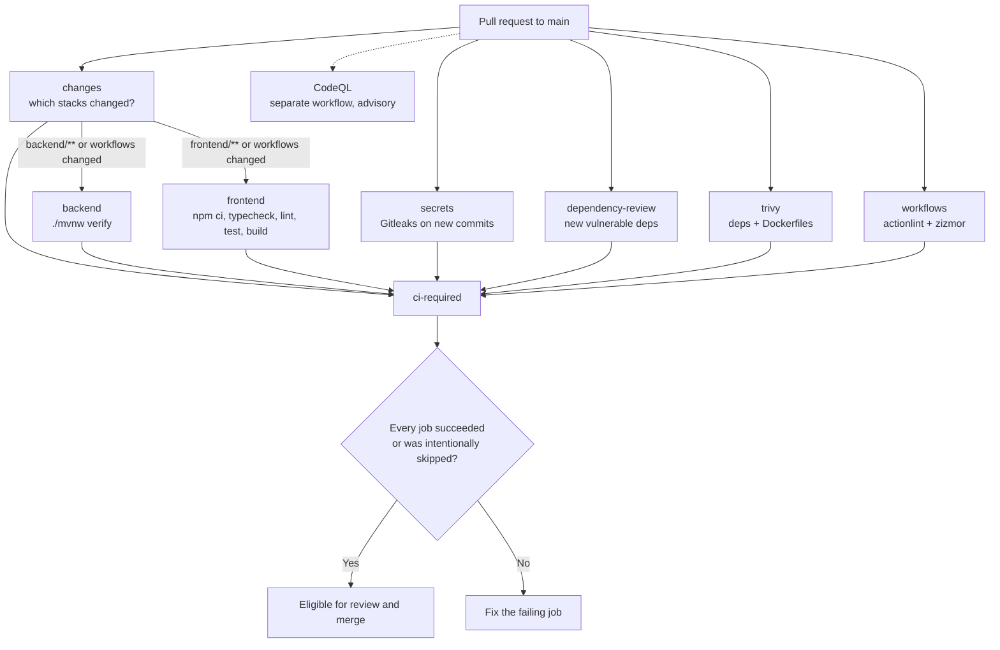

# CloudForge CI architecture

> Scope: continuous **integration** only. Nothing in CI deploys, publishes images, or holds cloud
> credentials, and CI can never trigger real provisioning (the backend's providers are `disabled`
> by default and the tests use scripted fakes; see ADR-0008).

## 1. Overview

Three GitHub Actions workflows:

| Workflow | Triggers | Purpose | Blocks merges? |
|---|---|---|---|
| [`ci.yml`](../../.github/workflows/ci.yml) | PR to `main`, push to `main`, manual | Build, test, secret scan, dependency and config scan, workflow lint; on `main` also store build artifacts | **Yes**, through `ci-required` |
| [`codeql.yml`](../../.github/workflows/codeql.yml) | PR to `main`, push to `main`, weekly, manual | CodeQL SAST for Java and TypeScript, results in Code scanning | Not yet (advisory, see [CodeQL](#codeql)) |
| [`security-scheduled.yml`](../../.github/workflows/security-scheduled.yml) | Weekly, manual | Full-history secret scan, full vulnerability scan to Code scanning, online workflow audits | No (alerts and notifications) |

Supporting files: [`dependabot.yml`](../../.github/dependabot.yml), [`CODEOWNERS`](../../.github/CODEOWNERS),
[`.gitleaks.toml`](../../.gitleaks.toml), [`.trivyignore.yaml`](../../.trivyignore.yaml), [`frontend/.nvmrc`](../../frontend/.nvmrc).

### Pull request pipeline



All jobs except `backend` and `frontend` start immediately and run in parallel; those two wait only
for the few-second `changes` job. `ci-required` waits for everything.

## 2. Workflow responsibilities

### `ci.yml`

| Job | What it does | Runs when |
|---|---|---|
| `changes` | `git diff base...head` to decide whether backend and/or frontend changed | always |
| `backend` | Java 21 (Temurin) + Maven wrapper: `./mvnw verify` | backend or workflow files changed; every push to `main` |
| `frontend` | Node from `.nvmrc`: `npm ci`, `typecheck`, `lint`, `test:run`, `build` | frontend or workflow files changed; every push to `main` |
| `secrets` | Gitleaks on the commits the PR/push adds | always |
| `dependency-review` | Blocks PRs that **add** a dependency with a HIGH/CRITICAL advisory | pull requests |
| `trivy` | Fixable HIGH/CRITICAL vulnerabilities in `pom.xml`/`package-lock.json`, Dockerfile misconfigurations | always |
| `workflows` | actionlint (incl. ShellCheck) and zizmor (offline) over `.github/workflows` | always |
| `ci-required` | Aggregates all of the above into one status | always (`if: always()`) |

### Trigger conditions

- **Pull requests to `main`:** full PR pipeline. A new commit cancels the PR's previous run (`concurrency`).
- **Push to `main`** (a merge): everything runs regardless of paths, nothing is cancelled, and build artifacts are stored.
- **`workflow_dispatch`:** manual full run (useful after changing repository settings).
- The workflows have **no workflow-level `paths:` filters**. That keeps `ci-required` reporting on every PR; path skipping is done per job (see section 7).

## 3. Backend validation

```
./mvnw --batch-mode --no-transfer-progress verify
```

Checked in the effective POM rather than assumed. The Spring Boot parent binds failsafe's
`integration-test` and `verify` goals, so this single command runs:

| Phase | What happens |
|---|---|
| validate | POM and wrapper are valid |
| compile / test-compile | `javac` for Java 21 |
| test | **surefire**: 23 `*Test` classes (unit and web-slice tests, Mockito) |
| package | Spring Boot executable jar (`target/backend-*.jar`) |
| integration-test | **failsafe**: 11 `*IT` classes against PostgreSQL 17 started by **Testcontainers** (`TestcontainersConfiguration`) |
| verify | fails the build if any integration test failed |

- No database service is configured and no real database is ever reachable. Each run gets throwaway containers from the runner's Docker.
- Maven dependencies are cached by `actions/setup-java` (key: `backend/pom.xml`).
- Surefire and failsafe XML reports are uploaded as `backend-test-reports-<sha>` (14 days), including on failure.

## 4. Frontend validation

| Step | Command | Notes |
|---|---|---|
| Node | `.nvmrc` → Node 22 | matches `engines` |
| Install | `npm ci --no-audit --no-fund` | lockfile-exact; fails if `package-lock.json` is out of sync |
| Types | `npm run typecheck` | `tsc -b` strict |
| Lint | `npm run lint` | ESLint, `typescript-eslint` strict type-checked + React hooks |
| Tests | `npm run test:run -- --reporter=default --reporter=junit …` | Vitest; JUnit report uploaded as `frontend-test-report-<sha>` |
| Build | `npm run build` | typecheck + Vite production build |

**Formatting is not checked:** neither project has a formatter configured (no Prettier, Spotless or
Checkstyle). Adding one is a team decision (it reformats every file), so it's listed under
[future improvements](#14-future-improvements) instead of being invented here.

## 5. Security scanning

### Tools and why each one is here

| Tool | Finds | Where | Why not something else |
|---|---|---|---|
| **Gitleaks** | committed secrets | PR (new commits), weekly (full history) | Fast, offline, good default rules |
| **Dependency Review** | vulnerable dependencies *added* by a PR | PR | GitHub-native, knows exactly what the PR changes |
| **Trivy** | known CVEs in all dependencies (incl. transitive Maven), Dockerfile misconfigurations | PR (gate), weekly (full report) | Covers transitive Maven deps that GitHub's static `pom.xml` graph doesn't |
| **CodeQL** | code vulnerabilities (injection, auth flaws…) in Java and TypeScript | PR, main, weekly | GitHub-native SAST, free for public repos |
| **actionlint** | broken workflow syntax/expressions, shell bugs (ShellCheck) | PR | Catches CI breakage before merge |
| **zizmor** | insecure workflow patterns (injection, over-broad permissions, credential persistence, unpinned actions) | PR (offline), weekly (online audits) | Purpose-built for GitHub Actions security |

Two implementation details that matter, both found while testing the jobs locally:

- **Gitleaks can pass while scanning nothing.** The mounted checkout belongs to a different user than git inside the container, so git refuses it ("dubious ownership") and Gitleaks still exits 0. The jobs therefore pass a `safe.directory=/repo` exception through git's environment-based config, and a **guard fails the job if the range contains commits but Gitleaks reports scanning 0**.
- **Trivy must not fetch Maven POMs itself.** Resolving `pom.xml` makes Trivy download every transitive POM from Maven Central, which answered `429 Too Many Requests`; shared runner IPs make that likely. The jobs first run `./mvnw dependency:resolve` into the cached local repository, mount it read-only into the container, and scan with `--offline-scan`.

Trivy's secret scanner is **not** enabled, because Gitleaks already does that job. Trivy IaC scanning
covers only the two Dockerfiles; there is no Terraform, Kubernetes or Helm in the repository, so no
IaC jobs exist.

### Security policy

| Finding | Initial enforcement |
|---|---|
| Secret in a new commit (any Gitleaks rule) | **Blocks** (`secrets` job). Gitleaks does not verify secrets against providers, so every match is treated as real until proven otherwise. |
| PR adds a dependency with a HIGH/CRITICAL advisory | **Blocks** (`dependency-review`, `fail-on-severity: high`) |
| Fixable HIGH/CRITICAL vulnerability or Dockerfile misconfiguration anywhere in the repo | **Blocks** (`trivy`), unless baselined in `.trivyignore.yaml` |
| Unfixable HIGH/CRITICAL, all MEDIUM/LOW | Reported weekly to Code scanning; not blocking |
| CodeQL alerts | Reported on the PR and in Code scanning; advisory for now |
| Workflow misconfiguration (zizmor) or broken workflow (actionlint) | **Blocks** (`workflows`) |

**Baselines are explicit and expire.**

- `.gitleaks.toml` allows two reviewed test fixtures. The JWT key is allowed only as that exact value in that one file; the password-policy test file is allowed by exact path.
- `.trivyignore.yaml` lists accepted vulnerabilities, each with a statement and an `expired_at` date. When it expires the PR gate fails again, so the finding must be fixed or re-justified in a reviewed PR.
- Both files are covered by CODEOWNERS.

Current baseline (2026-11-03):

| ID | Component | Status |
|---|---|---|
| CVE-2026-102554 (HIGH) | `com.google.guava:guava` 33.6.0-jre (transitive) → fix 33.7.2 | Baselined until **2026-12-03**; upgrade via Dependabot |

No `continue-on-error` is used anywhere.

### CodeQL

- Languages `java-kotlin` and `javascript-typescript`, both with **`build-mode: none`**: CodeQL reads the source directly, so the analysis job runs no project code and needs no Maven or npm build.
- Query suite `security-extended`, the same on every trigger, so PR and weekly results are comparable.
- Findings don't fail the workflow. **Enforcement step, after triaging the first results:** add a repository ruleset with *Require code scanning results* (CodeQL, "High or higher" security alerts). GitHub then blocks merges that introduce new high/critical alerts without blocking on pre-existing ones.
- Don't enable CodeQL **default setup** in repository settings at the same time; it conflicts with this advanced-setup workflow.

### Scheduled security

`security-scheduled.yml`, Mondays 04:43 UTC:

| Job | What it does |
|---|---|
| `secrets-full-history` | Gitleaks over every commit |
| `dependencies-full` | Trivy, all severities including unfixed, uploaded as SARIF to Code scanning (category `trivy-weekly`), then fails on fixable HIGH/CRITICAL so owners get a failed-run notification when a new CVE affects existing dependencies |
| `workflows-online` | zizmor with online audits (known-vulnerable actions, impostor commits) using the read-only job token |

## 6. Action and image pinning

**GitHub-maintained actions are pinned to full commit SHAs**, resolved from the GitHub API on
2026-11-03, following annotated tags down to the commit:

| Action | Version | Commit |
|---|---|---|
| `actions/checkout` | v7.0.1 | `3d3c42e5aac5ba805825da76410c181273ba90b1` |
| `actions/setup-java` | v6.1.0 | `b843ebf9b913146b38da2eaa7aeddf76074ae1ad` |
| `actions/setup-node` | v7.1.0 | `949feb2413d6458794dcd2491c4babbbce0c15c1` |
| `actions/upload-artifact` | v7.0.2 | `cf430e030ddbb5b0abf93d22962f4752f3646cd9` |
| `actions/dependency-review-action` | v5.0.0 | `a1d282b36b6f3519aa1f3fc636f609c47dddb294` |
| `github/codeql-action` (`init`, `analyze`, `upload-sarif`) | v4.39.1 | `9b3254085494b55a0f7c4c2b3d2d52cc712ce370` |

**Third-party scanners run as official container images pinned by digest**, not through third-party
actions:

| Image | Version | Digest (multi-arch index) |
|---|---|---|
| `ghcr.io/gitleaks/gitleaks` | v8.30.1 | `sha256:c00b6bd0aeb3071cbcb79009cb16a60dd9e0a7c60e2be9ab65d25e6bc8abbb7f` |
| `ghcr.io/aquasecurity/trivy` | 0.76.1 | `sha256:790fd66d1697395d8693d1acaa1ea702406a20f109b6fc7bac8db623eca6c06c` |
| `rhysd/actionlint` | 1.7.12 | `sha256:b1934ee5f1c509618f2508e6eb47ee0d3520686341fec936f3b79331f9315667` |
| `ghcr.io/zizmorcore/zizmor` | 1.32.0 | `sha256:3014cc8f68f663935f69b3c3e0e41f5ce102b268d97db13db0f62208747f860d` |

Why containers:

- **Supply chain.** In March 2026, 76 of 77 `aquasecurity/trivy-action` tags were force-pushed with an infostealer (CVE-2026-33634, in CISA's KEV catalog). An action runs inside the job with the job's token; a digest-pinned image runs isolated, mounted read-only, with no token, except the weekly online zizmor job, which gets a read-only one.
- **No licence dependency.** `gitleaks-action` needs a licence key for organization-owned repositories; the Gitleaks CLI doesn't.

### Updating pinned versions

- **Actions:** Dependabot (`github-actions` ecosystem, weekly, 7-day cooldown) opens PRs that update the SHA and the version comment.
- **Scanner images:** Dependabot doesn't update `docker run` references inside workflows. Update them quarterly or when a scanner release matters. Change the tag and the digest together; get the digest with `docker buildx imagetools inspect <image>:<tag>` (first `Digest:` line).

## 7. Aggregate required check (`ci-required`)

Branch protection requires only `ci-required`. It runs with `if: always()`, so it reports a status
even when other jobs fail or are skipped, and a PR can never wait forever on a missing check.

Decision rules (tested against 13 scenarios before merging, see section 11):

| Job result | Outcome |
|---|---|
| `success` | ok |
| `skipped`, and skipping was expected | ok. Allowed only for `backend` (no backend/workflow change), `frontend` (no frontend/workflow change) and `dependency-review` (not a PR). |
| `skipped` unexpectedly, e.g. backend changed but its job was skipped | **fail** |
| `failure` or `cancelled` | **fail** |
| `changes` itself failed | **fail** (the stacks are then skipped, and that skip doesn't count as intended) |

Path-based skipping is therefore safe: a docs-only PR skips both stacks and passes; a PR touching
`backend/` cannot pass without the backend job succeeding; a change to any workflow runs both stacks.

## 8. Main branch build

On every push to `main` (the merged commit), all jobs run regardless of paths, and:

| Artifact | Contents | Retention |
|---|---|---|
| `backend-jar-<sha>` | Spring Boot jar + `build-info.json` | 30 days |
| `frontend-dist-<sha>` | Production bundle + `build-info.json` | 30 days |
| `backend-test-reports-<sha>`, `frontend-test-report-<sha>` | JUnit XML | 14 days |

`build-info.json` records the component, commit SHA, ref, run ID, build time and toolchain version.
Nothing is deployed and no image is pushed.

## 9. Branch protection recommendations

Configure in **Settings → Rules → Rulesets** (or branch protection) for `main`. CI doesn't change these settings:

1. Require a pull request before merging; at least 1 approval; dismiss stale approvals on new commits.
2. Require review from Code Owners. With `CODEOWNERS`, changes to `.github/` and the scanner baselines need the owner's approval.
3. Require status checks: **`ci-required`** only, with "Require branches to be up to date before merging".
4. Block force pushes and deletions.
5. After the first CodeQL baseline is triaged: *Require code scanning results*, CodeQL, security alerts "High or higher".
6. Enable in **Settings → Code security**: Dependency graph (required by dependency review), Dependabot alerts, Dependabot security updates, Secret scanning and Push protection.
7. **Settings → Actions → General:** workflow permissions "Read repository contents"; don't allow Actions to create or approve pull requests; for fork PRs, require approval for first-time contributors.

## 10. Secrets and permissions

- **No secrets are used by any workflow.** The only credential is the automatic, short-lived `GITHUB_TOKEN`.
- `permissions: {}` at workflow level; every job declares the minimum: `contents: read`, plus `security-events: write` only for the jobs that upload to Code scanning. `ci-required` has no permissions.
- `actions/checkout` always uses `persist-credentials: false`, so the token isn't left in `.git/config` for later steps.
- Event data (branch names, SHAs) reaches scripts only through `env:`, never by `${{ }}` interpolation inside `run:`, which prevents script injection.
- `pull_request` (not `pull_request_target`): fork PRs run with a read-only token and no secrets.
- No AWS, GCP or Kubernetes credentials exist in CI, and none are needed: tests use Testcontainers and scripted provider fakes.

## 11. Running the checks locally

```bash
# Backend: same command as CI (needs JDK 21 and Docker running for the *IT tests)
cd backend && ./mvnw -B -ntp verify        # ./mvnw test for unit tests only, no Docker

# Frontend: same steps as CI (Node 22)
cd frontend && npm ci && npm run typecheck && npm run lint && npm run test:run && npm run build
#   or simply: npm run check

# Security (from the repository root, Docker running)
docker run --rm -v "$PWD:/repo:ro" \
  -e GIT_CONFIG_COUNT=1 -e GIT_CONFIG_KEY_0=safe.directory -e GIT_CONFIG_VALUE_0=/repo \
  ghcr.io/gitleaks/gitleaks:v8.30.1 git /repo --config /repo/.gitleaks.toml --redact
(cd backend && ./mvnw -B -ntp dependency:resolve)
docker run --rm -v "$PWD:/repo:ro" -v "$HOME/.m2/repository:/root/.m2/repository:ro" -w /repo \
  ghcr.io/aquasecurity/trivy:0.76.1 fs --scanners vuln,misconfig --severity HIGH,CRITICAL \
  --ignore-unfixed --offline-scan --skip-dirs frontend/node_modules --skip-dirs backend/target \
  --ignorefile .trivyignore.yaml --exit-code 1 .
docker run --rm -v "$PWD:/repo:ro" -w /repo rhysd/actionlint:1.7.12
docker run --rm -v "$PWD:/repo:ro" -w /repo ghcr.io/zizmorcore/zizmor:1.32.0 --offline .github/workflows
```

On Windows Git Bash, prefix the `docker run` commands with `MSYS_NO_PATHCONV=1`. Locally, `--skip-dirs`
keeps Trivy out of `node_modules` and `target`, which a CI checkout doesn't have; scanning them makes
the Dockerfile analysis time out.

### Committing from Windows: keep `mvnw` executable

With Git's Windows default `core.filemode=false`, `backend/mvnw` is committed as `100644`, and CI fails
at `./mvnw` with "Permission denied". Mark it executable in the index once (line endings are already
handled by `backend/.gitattributes`):

```bash
git add backend/mvnw
git update-index --chmod=+x backend/mvnw
git ls-files -s backend/mvnw      # must show 100755
```

## 12. Investigating failures

| Failing job | Where to look | Typical fix |
|---|---|---|
| `ci-required` | its log lists each job with its result | open the job marked ❌; `ci-required` never fails on its own |
| `backend` | log, then artifact `backend-test-reports-<sha>` (surefire = unit, failsafe = IT) | run `./mvnw verify` locally; Testcontainers errors usually mean the IT can't start PostgreSQL |
| `frontend` | the failing step (typecheck/lint/tests/build); artifact `frontend-test-report-<sha>` | run the same `npm run …` locally |
| `secrets` | log shows file, line, rule (value redacted) | remove the secret, **rotate it** (it's in history), rewrite the commit if not yet merged; a false positive gets a narrow, reviewed entry in `.gitleaks.toml`. "Secret scan did not run" means git refused the repository or the range was wrong: a broken scan, not a clean one |
| `backend` fails at `./mvnw` with "Permission denied" | `git ls-files -s backend/mvnw` | committed without the executable bit; see "Committing from Windows" in section 11 |
| `dependency-review` | job summary lists the package and advisory | use the patched version shown |
| `trivy` | table of CVEs or Dockerfile findings | upgrade the dependency, or add a justified, expiring entry to `.trivyignore.yaml` |
| `workflows` | annotations on the workflow file | fix syntax (actionlint) or the security issue (zizmor explains each audit) |
| CodeQL | Security → Code scanning, or the PR's annotations | fix, or dismiss with a reason (false positive / used in tests) |

## 13. Current limitations

- **Not yet run on GitHub.** Validated locally: actionlint with ShellCheck and zizmor in their pinned containers; schema checks; the gating logic (20 scenarios) and the Gitleaks step (clean, leaked secret, refused repository) run as their exact scripts; `./mvnw verify` with all integration tests; the frontend steps; and every scanner container against a CI-equivalent checkout. Still unverified: real runner behaviour, timings, artifact uploads, Dependency Review and the CodeQL/SARIF uploads.
- **Dependency Review sees Maven direct dependencies only.** GitHub reads `pom.xml` statically. Transitive Maven vulnerabilities are caught by Trivy instead.
- **Scanner image digests aren't updated by Dependabot** (see section 6).
- **Trivy downloads its vulnerability database on every run** (~10–20 s) from GHCR; a GHCR outage fails the job, which is visible, not silent.
- **No formatting or coverage gate** (no formatter or coverage tool configured yet).
- **Gitleaks matches patterns; it doesn't verify** whether a secret is live. A false positive needs a reviewed allowlist entry.

Measured locally (Windows laptop, warm caches, not a GitHub runner):

| Job | Local time |
|---|---|
| backend `./mvnw verify` (207 unit + 84 integration tests) | 247 s |
| frontend (typecheck, lint, tests, build) | 117 s |
| Trivy (resolve 21 s + scan, incl. DB download) | ~165 s |

All jobs run in parallel, so the PR wall time is roughly the backend job plus runner setup: within
the 5–10 minute target if runners are comparable. Confirm with the first real runs (Actions → run →
job durations) before tuning.

## 14. Future improvements

1. **Enforce CodeQL** with code scanning merge protection after the first triage (section 5).
2. **Formatter checks:** Spotless (Java) and Prettier (frontend) in one dedicated reformatting PR, then a `--check` step.
3. **Coverage:** JaCoCo + Vitest coverage published as artifacts; a threshold on *new* code once a baseline exists.
4. **Maven dependency submission**, so Dependency Review also sees transitive Maven dependencies.
5. **Merge queue** (`merge_group` trigger) once several people merge concurrently.
6. **OpenSSF Scorecard** for repository-level security posture.
7. **Image builds in CI** (build-only, then scan with Trivy) when container delivery is designed. Registry publishing, signing and SBOMs belong to the future CD design.
