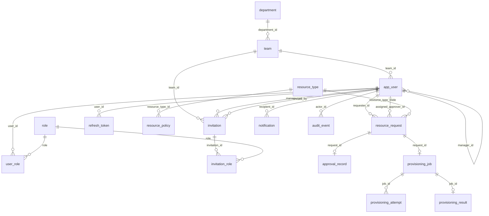

# Database schema

PostgreSQL 17. Flyway migrations in `backend/src/main/resources/db/migration` are the **only** source of truth; Hibernate runs with `ddl-auto=validate`.

## Conventions

- `V<n>__<description>.sql`. A merged migration is never edited; fix forward.
- UUID primary keys (time-ordered, generated in the application).
- `TIMESTAMPTZ` columns, written in UTC (`hibernate.jdbc.time_zone=UTC`).
- Explicit `NOT NULL`, foreign keys, and unique constraints named `uk_<table>_<cols>`.
- An index on every foreign key not already covered by a composite index.
- JSONB only for provider-specific payloads (`resource_request.spec`, `audit_event.details`), always validated in code.
- An optimistic-locking `version BIGINT NOT NULL` on mutable aggregates.

## Migration history

| Version | Content |
|---|---|
| V1 | Baseline: establishes Flyway ownership (schema comment only) |
| V2 | `department`, `team`, `role` (seeded), `app_user`, `user_role`, `invitation`, `invitation_role` |
| V3 | `app_user.failed_login_attempts`/`locked_until`, `invitation.invited_by`, `refresh_token` |
| V4 | `resource_type` (3 seeded types), `resource_policy` (JSONB `constraints`) |
| V5 | `resource_request` (+ number sequence), `approval_record` |
| V6 | `audit_event` + append-only triggers |
| V7 | `provisioning_job`, `provisioning_attempt`, `provisioning_result` |
| V8 | `notification` |
| V9 | `login_throttle` (per-client fixed-window counters) |
| V10 | `password_reset_token`; `pg_trgm` extension and trigram index for request text search |

## Current tables

| Constraint / index | Purpose |
|---|---|
| `uk_department_name` on `lower(name)` | Case-insensitive unique department names |
| `uk_team_department_name` on `(department_id, lower(name))` | Unique team name per department; also serves the FK |
| `uk_app_user_email` + `ck_app_user_email_lowercase` | Case-insensitive unique email without `citext` |
| `ck_app_user_not_own_manager` | Nobody manages themselves (DB backstop) |
| `ix_app_user_manager`, `ix_app_user_team` | Direct-report lookups, team filters, FK checks |
| `uk_invitation_token_hash` | Token lookup at registration |
| `uk_invitation_pending_email` (partial, `status = 'PENDING'`) | At most one open invitation per email |
| `uk_refresh_token_hash` | Refresh lookup by token hash |
| `ix_refresh_token_user` (partial, `revoked_at IS NULL`) | Revoke all of a user's live tokens |
| `ix_refresh_token_family` | Family revocation on reuse or logout |
| `ix_refresh_token_expires_at` | Future cleanup job for expired tokens |
| `uk_resource_type_code` | One row per type code |
| `uk_resource_policy_type_environment` | One policy per type and environment; also serves the FK and policy lookups |
| `ck_resource_policy_constraints_object` | `constraints` is always a JSON object |
| `ix_resource_request_requester (requester_id, created_at DESC)` | My requests, newest first |
| `ix_resource_request_approver (assigned_approver_id, status, submitted_at)` | Manager inbox |
| `ix_resource_request_created_at` | Admin and auditor listing |
| `ix_resource_request_quota (requester_id, resource_type_code, environment, status)` | Quota count at submission |
| `ck_resource_request_not_self_approver`, `ck_resource_request_submitted` | Self-approval impossible; submitted rows have an approver |
| `uk_approval_record_request`, `ck_approval_record_reject_comment` | One decision per request; rejections need a comment |
| `ix_audit_event_entity (entity_type, entity_id, occurred_at)` | Entity history |
| `ix_audit_event_occurred_at`, `ix_audit_event_actor` | Auditor search by time and by actor |
| `audit_event_append_only` / `audit_event_no_truncate` triggers | Audit history cannot be modified |
| `ix_provisioning_job_due (next_run_at) WHERE status IN ('QUEUED','AWAITING_PROVIDER')` | Worker claim query (partial, stays small) |
| `ix_provisioning_job_lease (locked_until) WHERE status = 'RUNNING'` | Expired-lease recovery |
| `uk_provisioning_job_request`, `uk_provisioning_job_idempotency_key` | One job per request; stable idempotency key |
| `ck_provisioning_job_lease` | RUNNING ⇔ lease held |
| `ix_notification_recipient`, `ix_notification_unread` (partial) | Inbox and unread count |

